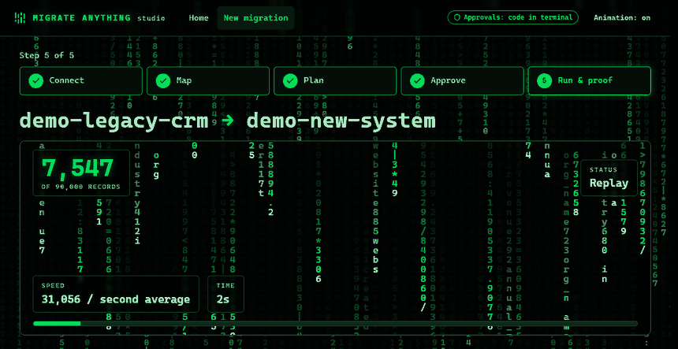
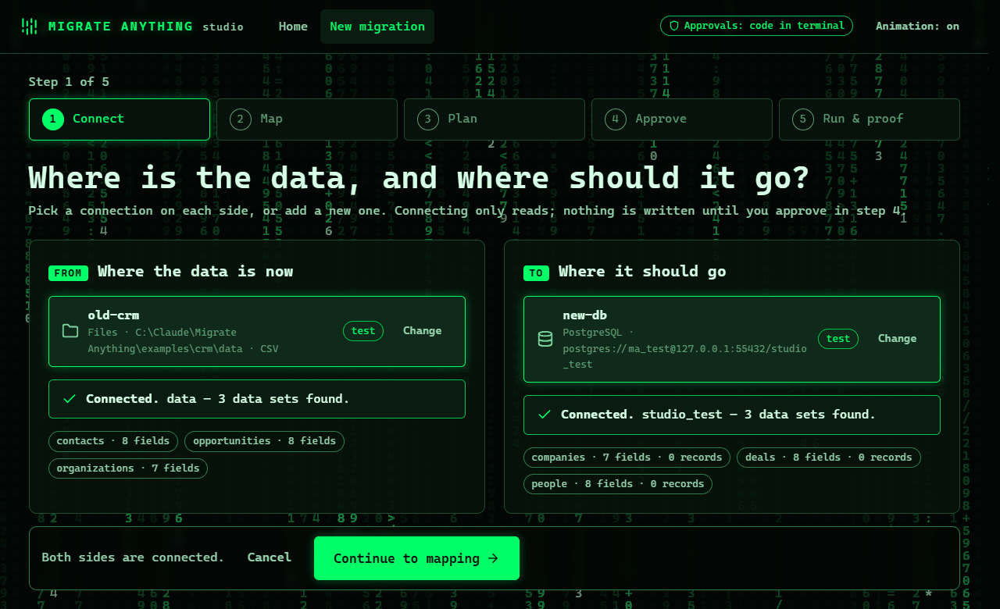
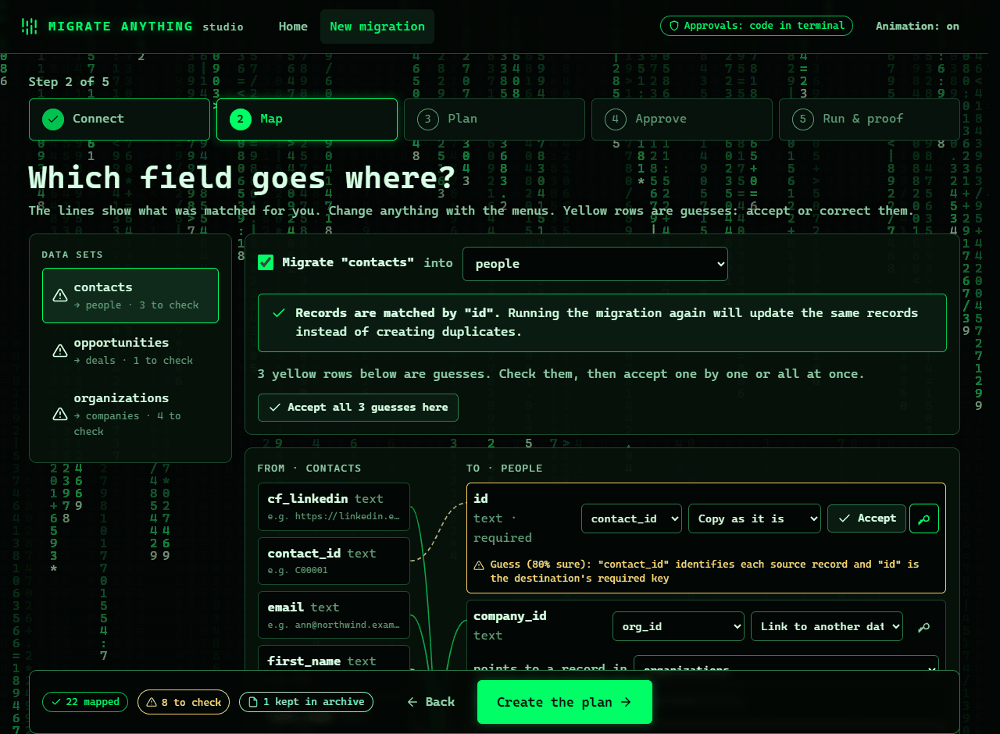
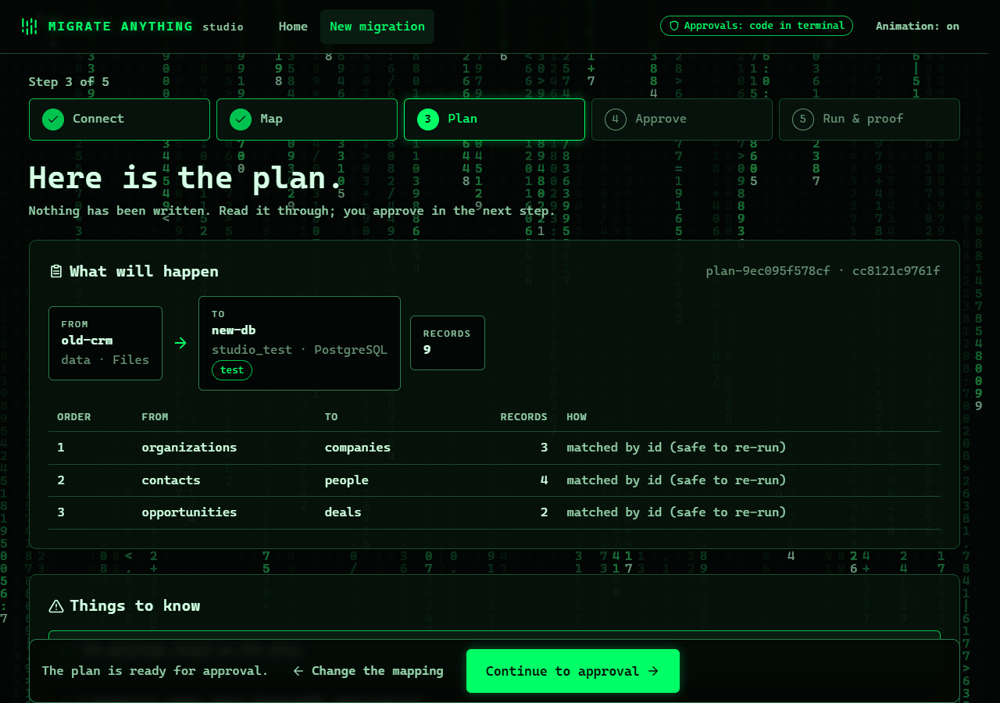
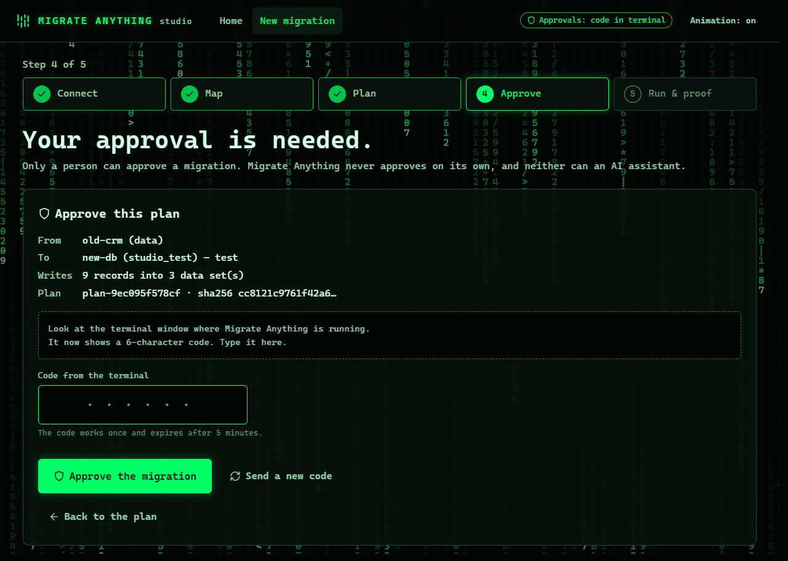
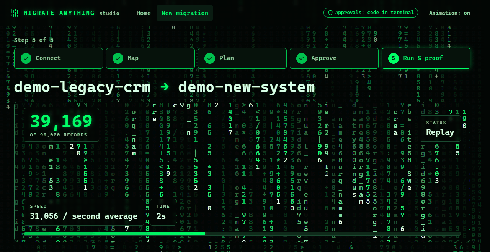
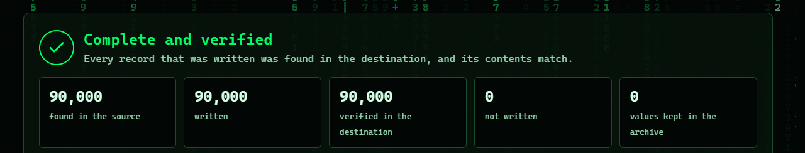
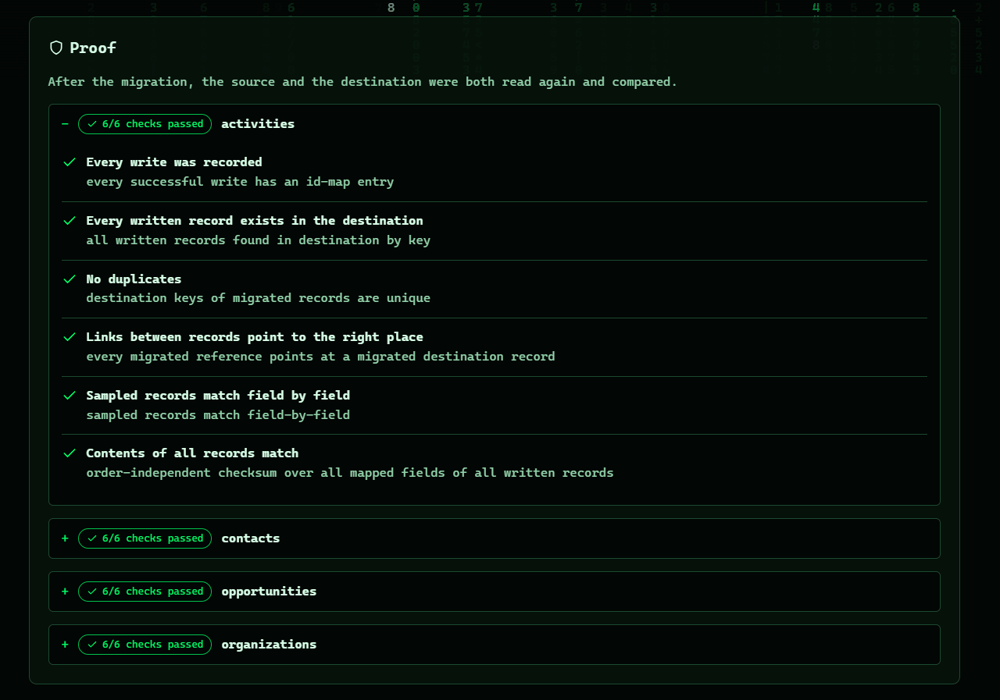

<p align="center">
  
</p>

<p align="center">
  <b>Connect two systems. Check the mapping. Approve. Watch every record land. Get proof.</b><br>
  Files, PostgreSQL, and any REST API with an OpenAPI description — driven from a browser,
  a terminal, or your AI assistant.
</p>

<p align="center">
  
  
  
  
</p>

<p align="center">
  
</p>
<p align="center"><sub>
  Migrate Anything Studio replaying a real run of its built-in demo (90,000 made-up CRM records).
  The rain is the data: it gets heavier the faster records move, and the brighter columns spell the
  field names being migrated.
</sub></p>

---

## Start in two steps

> **Status:** release candidate `v1.0.0-rc.1`, verified on Windows. There are no ready-made
> downloads yet, so the first start builds from source.

You need [Rust](https://rustup.rs) once, to build it (on Windows the installer also sets up the
Microsoft C++ build tools).

**1. Get the code and start the demo**

```sh
git clone https://github.com/behrang80/migrate-anything.git
cd migrate-anything
```

| Windows | macOS / Linux |
|---|---|
| `studio.cmd demo` <br>(or double-click **`studio.cmd`** and press *Try the demo*) | `./studio.sh demo` |

The first start builds the program (a few minutes). After that it starts in seconds.

**2. Follow the screen**

Your browser opens **Migrate Anything Studio** with a demo migration prepared: 90,000 made-up
CRM records, on your computer only. Press **Create the plan**, approve it with the one-time code
that appears in the terminal window, and watch it run. When it finishes you get a verified report.

Ready for your own data? Start Studio without `demo` (`studio.cmd` or `./studio.sh`) and press
**Start a migration**.

<details>
<summary>Other ways to install and start</summary>

```sh
cargo install --path apps/cli --locked   # puts `migrate-anything` on your PATH
migrate-anything                         # opens Studio
migrate-anything demo                    # opens Studio with the demo ready
migrate-anything doctor                  # checks the installation
```

Docker (command line and MCP server; Studio is meant to run directly on your machine):
`docker build -t migrate-anything . && docker run --rm -it migrate-anything doctor`

Options: `migrate-anything ui --port 5000` picks the port (default 4747, or a free one),
`--no-open` does not open the browser, and `--home <folder>` (or `MA_HOME`) chooses where settings
and job history are kept (default `~/.migrate-anything`).
</details>

## The five steps

<table>
<tr>
<td width="50%" valign="top">

### 1 · Connect
Say where the data is and where it should go. Pick a folder of CSV or JSON files, a PostgreSQL
database, or a web API. Connecting only reads.

For a web API there is nothing to install: give Studio the API's OpenAPI description and it
**builds and tests a connector by itself**.

</td>
<td width="50%"></td>
</tr>
<tr>
<td valign="top">

### 2 · Map
Studio pairs data sets and fields for you, even when names differ (`contacts` → `people`,
`first_name` → `given_name`). Confident matches are accepted; guesses are yellow and wait for you.
Change anything with the menus: convert types, translate values, link records to each other.

Fields with no place in the destination are **kept in an archive, never dropped**.

</td>
<td></td>
</tr>
<tr>
<td valign="top">

### 3 · Plan
Read exactly what will happen, in what order, and how many records. A **test run** reads real
records and transforms them without writing anything, so problems show up before the migration.

</td>
<td></td>
</tr>
<tr>
<td valign="top">

### 4 · Approve
Nothing is written until **you** approve. Studio shows a one-time code in the terminal window it
was started from; you type it in the browser. A script, a web page or an AI assistant cannot do
that for you.

The approval is signed and tied to this exact plan. Change the plan and it must be approved again.

</td>
<td></td>
</tr>
<tr>
<td valign="top">

### 5 · Run &amp; proof
Watch the records move. Pause, resume or cancel at any time; if the computer crashes, the
migration continues from the last saved point without duplicates.

Then Studio reads both systems again and compares them: counts, IDs, links between records, and
a checksum over the contents of every record.

</td>
<td><br></td>
</tr>
</table>

<details>
<summary>See the checks behind "Complete and verified"</summary>
<p align="center"></p>
</details>

## What you can connect

| System | As source | As destination | Good to know |
|---|---|---|---|
| **Files**: CSV, JSON Lines, JSON arrays | ✅ | ✅ creates the files | One file per data set (`customers.csv`). Studio suggests which column is the ID. |
| **PostgreSQL** | ✅ | ✅ into existing tables | Foreign keys are followed, so parents are written before children. |
| **Any REST API with an OpenAPI 3 description** | ✅ | ✅ after you activate the generated connector | Paging, API keys and bearer tokens, rate limits and retries are handled. |

Anything else is on the [roadmap](#roadmap). See [Known limitations](#known-limitations) for what
is not supported yet.

## Why you can trust it

* **You approve, nobody else.** No write happens without a signed, unexpired approval from a
  person at the terminal, bound to the exact plan, systems, operations and environment.
* **Nothing disappears silently.** Records that cannot be written and values with no place in the
  destination are stored locally with the reason, and listed in the report.
* **Proof, not a progress bar.** After the run the source and destination are read again and
  compared. The report says "verified" only if they match.
* **Interruptions are safe.** Progress is saved in small steps; a killed process resumes without
  gaps or duplicates.
* **Your data stays with you.** Everything runs on your machine. No record is sent to an AI
  service or anywhere else. Passwords and API keys are encrypted on disk and never shown again.
* **Studio is local only.** It listens on `127.0.0.1`, needs the private link printed in your
  terminal, and refuses requests from other websites.

Details: [SECURITY.md](SECURITY.md) and the [threat model](docs/security/THREAT_MODEL.md).

## Use it from an AI assistant

Migrate Anything is also an [MCP](https://modelcontextprotocol.io) server, so Claude Code, Cursor
or any MCP client can do the legwork: explore both systems, build a connector for an API it has
never seen, propose the mapping, run the test run and start approved jobs.

```sh
claude mcp add migrate-anything -- migrate-anything mcp serve
```

```json
{ "mcpServers": { "migrate-anything": { "command": "migrate-anything", "args": ["mcp", "serve"] } } }
```

Then ask in plain words:

> Migrate all our data from our old system to our new system. Find out how both work, build the
> connectors you need, keep relationships and custom fields, and show me the plan before anything
> is written.

The assistant **cannot approve**, read stored credentials, or point an existing connection
somewhere else. You approve in Studio or with `migrate-anything plan approve <plan-id>`.

## Command line

Everything Studio does is available as commands, for scripts and servers.

```sh
migrate-anything connections add legacy --kind files --env production \
  --settings '{"path":"examples/crm/data","format":"csv","id_fields":{"organizations":"org_id","contacts":"contact_id"}}'
migrate-anything connections add target --kind files --env test --settings '{"path":"out","format":"jsonl"}'
migrate-anything mapping suggest --source legacy --dest target --out mapping.json   # review and edit
migrate-anything plan create --source legacy --dest target --mapping mapping.json
migrate-anything plan preview <plan-id> --dry-run
migrate-anything plan approve <plan-id>      # shows the plan, asks for a one-time code
migrate-anything jobs start <plan-id>
migrate-anything verify <job-id>
migrate-anything report <job-id>
```

A system nobody has written a connector for:

```sh
migrate-anything credentials set fieldops-key            # stored encrypted
migrate-anything connections add fieldops --kind rest --env production \
  --settings '{"base_url":"https://api.example.com"}' --credential-ref fieldops-key --allow-host api.example.com
migrate-anything connectors generate --connection fieldops --id fieldops-api --openapi-url https://api.example.com/openapi.json
migrate-anything connectors test --connection fieldops
migrate-anything connectors activate fieldops-api@1.0.0  # needed before writing through it
```

Full walkthrough: [docs/getting-started/QUICKSTART.md](docs/getting-started/QUICKSTART.md).

## What works today

Every line below is covered by automated tests in this repository.

| Capability | Tested by |
|---|---|
| Studio: sign-in link, demo, mapping, plan, test run, approval with terminal code, run, pause/resume, verification, report; refuses other origins, hosts, wrong and reused codes | `apps/cli/tests/studio_ui.rs` |
| MCP server (stdio, 16 typed tools) and CLI over one shared Rust core | real stdio session |
| Discovery: files (CSV/JSON/JSONL), PostgreSQL catalogs, OpenAPI 3.x documents | demos 1–4 |
| **Automatic connector generation** from OpenAPI → validated spec → contract tests → registry | demo 4 |
| Mapping suggestions with confidence, explanation and evidence; guesses wait for review | unit tests, demos |
| Transformations: casts, concat/split, value translation, date parsing, exact decimal scaling, unit conversion, links between records, nested objects, sandboxed extensions | unit tests, demos 1–3 |
| Dependency planning including cycles (second pass), immutable SHA-256-hashed plans, test runs | demos 1, 3 |
| Human approval that an agent cannot grant (interactive terminal, signed, bound to plan hash, systems, connector versions, operations, environment, expiry) | demo 6 |
| Streaming execution, retries and backoff, rate limits, pause/resume/cancel, crash recovery | demo 5, including killed worker processes |
| Verification: counts, identifier coverage, duplicates, referential integrity, sampled field comparison, full content checksum | all demos |
| Exception archive: failed records and unmapped values preserved | demo 2 |
| WebAssembly extension sandbox (no imports; fuel, memory and deadline limits) | demo 6 |
| 1,000,000-record benchmark | migrated and fully verified at ≈39k–68k records/s on a laptop SSD, peak memory ≈105 MB — [benchmarks/RESULTS.md](benchmarks/RESULTS.md) |

### The demonstrations

| Demo | Test | What it proves |
|---|---|---|
| 1 CRM | `apps/cli/tests/demo_crm.rs` | CSV CRM → PostgreSQL with a different schema, custom fields, value translation, foreign keys and a self-reference. 3,800 records, 5,840 relationships verified. |
| 2 Finance | `apps/cli/tests/demo_finance.rs` | Customers, invoices and lines with exact decimals and localized dates; bad records reported and preserved; audit history archived, never invented. |
| 3 Database | `apps/cli/tests/demo_postgres.rs` | PostgreSQL → PostgreSQL across schema differences and foreign keys; running it again changes nothing. |
| 4 Unknown system | `apps/cli/tests/demo_unknown_api.rs` | OpenAPI discovery → generated connector → contract tests → API→files and API→API migrations, through rate limiting. |
| 5 Interrupted | `apps/cli/tests/demo_interrupted.rs` | Worker killed between write and checkpoint, and hard-killed from outside; resume leaves no duplicates or gaps. Pause, resume, cancel. |
| 6 Security | `apps/cli/tests/demo_security.rs` | Unapproved, forged, expired and tampered approvals; approval without a terminal; malicious connector specs; SSRF; credential isolation; prompt injection; sandbox limits; an MCP session cannot approve. |

```sh
cargo test --workspace                                                          # all tests
MA_TEST_PG_URL=postgres://user@127.0.0.1:5432/postgres cargo test --workspace   # plus the PostgreSQL demos
cargo run -p ma-bench --release                                                 # benchmarks
```

## Known limitations

* Connectors: files, PostgreSQL, and REST APIs described by OpenAPI 3. No GraphQL, MySQL, SQL
  Server, Excel/XML or document stores yet.
* PostgreSQL destinations must already have their tables; Migrate Anything does not create them.
* OpenAPI 2.0 (Swagger) is not supported. OAuth 2.0 sign-in flows are not implemented (use a
  pre-issued token). API keys in query strings are refused by design.
* Attachments and binary content are not transferred in v1.
* Studio is for one person on their own computer. It cannot yet edit or remove a saved
  connection (save it again under the same name to change it), and activating a generated
  connector or approving needs the terminal window Studio was started from.
* Mapping suggestions are rule-based and local. No external AI provider ships in v1; when you use
  an AI assistant over MCP, the assistant reviews the mapping.
* For APIs that cannot look a record up by key, a write interrupted in flight is flagged
  `requires_reconciliation` instead of being sent twice.
* CSV cannot tell an empty value from a missing one.
* Approval protection assumes an agent cannot type into your interactive terminal. An agent with
  unrestricted shell access as your OS user can read local key files; use OS-level separation for
  stronger guarantees.
* One workspace on one machine, with state in SQLite.

## How it is built

```
 Browser ───local HTTP──► Studio ─┐
 AI client ──MCP/stdio──► ma-mcp ─┤                ┌─► connector factory (OpenAPI → spec → tests)
 Operator ──terminal───► CLI ─────┼─► ma-core ─────┼─► mapping · planning · execution · validation
                                  │  (one service  ├─► connectors: files · postgres · rest runtime
          detached worker ◄───────┘   layer)       ├─► sandbox (wasmtime)   security (keys, policy)
                                                   └─► persistence (SQLite, migrations, audit)
```

* **One core, three front ends.** Studio, the CLI and the MCP server are thin layers over the same
  Rust service, so they behave identically.
* **Jobs outlive requests.** A migration runs in its own worker process; closing the browser or
  the AI client does not stop it, and its state survives restarts and crashes.
* **Connectors are data before code.** A generated connector is a JSON description run by a
  trusted runtime. Custom transforms run as WebAssembly with no access to the outside world.
* **No build step for the interface.** Studio is plain HTML, CSS and JavaScript embedded in the
  binary: one file to ship, nothing to download at run time.

More: [docs/architecture/ARCHITECTURE.md](docs/architecture/ARCHITECTURE.md).

## Roadmap

GraphQL and more SQL dialects · OAuth 2.0 client credentials · attachment transfer · creating
destination tables · editing connections in Studio · PostgreSQL state backend and remote
authenticated MCP · optional AI mapping providers that see metadata only · ready-made binaries.

## Contributing · License

See [CONTRIBUTING.md](CONTRIBUTING.md) and [CODE_OF_CONDUCT.md](CODE_OF_CONDUCT.md).

**License:** not chosen yet. Until the owner decides, all rights are reserved (see
[LICENSE](LICENSE) and [docs/LICENSE_DECISION_CHECKLIST.md](docs/LICENSE_DECISION_CHECKLIST.md)).
This project is not described as open source.
